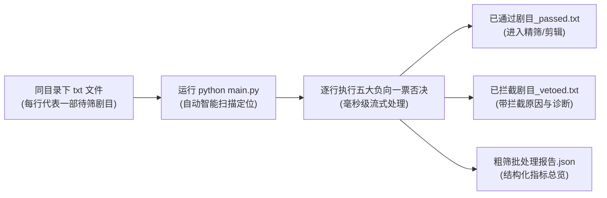

# filterDramaFunc: 短剧漫剧准入粗筛（负向过滤与一票否决）引擎

---

## 一、 需求背景与核心目标

在短剧和漫剧的工业化采购、剪辑与投放流转中，每天有数百部生肉剧目或分镜素材进入流程。若全部直接调用多模态大模型精审或推入剪辑渲染，算力与 API 费用巨大，且大量素材本质上是**“买量炮灰”**（毫无付费转化潜力的垃圾素材）。

本模块的目标是**在素材进入高成本计算前，执行低成本（<0.005元/部）、极速（<1秒）的负向一票否决粗筛**：
- **定位**：负向过滤层（过滤 60% 确定性低质物料）；
- **原则**：只做“一票否决”，不误杀普通商业素材；
- **吞吐**：单剧本地算子秒级计算完成。

---

## 二、 核心功能需求拆解（七大负向一票否决算子）

| 序号 | 算子名称 | 拦截目标 | 算法与底层原理 | 阈值标准 |
| :--- | :--- | :--- | :--- | :--- |
| **01** | **规格体量与品类检测** (`SpecDetector`) | 夭折测试微剧、碎片快餐剧、明确标注的沙雕漫 | 标签与元数据解析 + 文本品类挖掘 + 视频时长探测（**注：PPT漫严格由 06 算子基于画面视觉判定，不凭标题标签文本误判**） | 总集数 $\le 35$ 集 或 首集时长 $\le 50$ 秒 或 命中沙雕漫 ➔ 否决 |
| **02** | **叙事信息密度与提示词检测** (`DensityDetector`) | 通篇车轱辘吵架复读、废话口癖、未清洗的 AI 分镜提示词 | 词汇多样性 TTR、相邻句 Jaccard 重叠系数、分镜标签正则扫描 | 重复拉扯率 $\ge 70\%$ 或 提示词残留 ➔ 否决 |
| **03** | **人物主体与戏剧冲突检测** (`CharacterDetector`) | 纯风景散文说明文、无对抗冲突的平淡日常买菜日记 | 实体识别与人称代词抽取、二元对抗关系网与压迫复仇动词匹配 | 缺失主角主体 或 缺失戏剧对抗 ➔ 否决 |
| **04** | **画质硬伤与黑屏卡顿** (`VisualDefectDetector`) | 严重失焦模糊、长段黑屏、画面完全冻结卡顿 | 拉普拉斯算子方差检测模糊；灰度均值检测全黑帧；帧差法检测冻结帧 | 模糊度 $< 60$ 或 异常帧占比 $> 35\%$ ➔ 否决 |
| **05** | **沙雕/粗制简笔画检测** (`DoodleDetector`) | 火柴人、粗制草图、表情包大头贴、低幼黑白简笔涂鸦 | Canny 边缘检测算子量化线条复杂度（Edge Density），结合色彩直方图熵 | 边缘密度 $< 0.018$ 且 色彩熵 $< 1.8$ ➔ 否决 |
| **06** | **PPT漫/刚体推拉轮播检测** (`PPTDetector`) | 单张插画推拉平移缩放、无人物分层动画、纯定格死图的“伪动态漫” | OpenCV Farneback 稠密光流 + 全局 2D 仿射变换模型（动静分离：精准区分整图推拉平移与人物肢体/五官局部微动） | 刚体平移/缩放流 $\ge 0.85$ 或 纯静态死图 ➔ 否决 |
| **07** | **音频故障与静音检测** (`AudioGlitchDetector`) | 长时间静音、电流杂音、破音爆音（Clipping） | 音频 RMS 短时能量积分；极值采样检测波形截断失真 | 静音时长 $> 30\%$ 或 破音率 $> 0.05$ ➔ 否决 |

---

## 三、 架构设计与返回协议

### 1. 统一输出数据协议 (`CoarseFilterResult`)
```json
{
  "passed": false,
  "action": "VETO",
  "veto_reasons": ["DETECTED_PPT_SLIDESHOW", "LOW_INFORMATION_DENSITY"],
  "risk_level": "HIGH",
  "scores": {
    "ppt_rigid_ratio": 0.92,
    "doodle_edge_density": 0.045,
    "blur_laplacian_variance": 142.5,
    "narrative_redundancy_ratio": 0.78,
    "audio_clipping_ratio": 0.01
  },
  "diagnostics": [
    "连续 10 帧检测为全局刚体位移，无人物分层动作，判定为 PPT 漫",
    "剧本连续 30 秒文本词汇多样性仅 0.18，存在严重倒车注水现象"
  ],
  "execution_time_ms": 320.5
}
```

## 四、 核心工作流程（读取同目录 txt 文件批处理）

主程序 `main.py` 专为**“读取同目录下 txt 文件，每行代表一部剧”**的业务流深度定制：



### 1. 输入 txt 文件规则：
- 直接在 `filterDramaFunc` 目录下放入 `.txt` 文件（默认自动识别 `待筛剧目.txt`、`dramas.txt` 或同目录下任意包含剧目的文本文件）；
- **每行一部剧（换行符分隔）**，支持以下格式：
  1. **带书名号剧本**：`《战神归来：龙帅出狱》：三年之期已到，战神归位！当年江城苏家...`
  2. **普通剧本**：`豪门千金复仇记：你以为你伪造了这份亲子鉴定就能夺走顾家的一切？...`
  3. **纯剧本文本**：`阎王要你三更死，我能留你到五更！九转金针在此...`
  4. **本地视频路径**：`C:\videos\raw_episode_01.mp4`（自动走视觉/光流/音频检测算子）。

### 2. 启动方式：
```powershell
python main.py
```
*(也可以通过命令行指定特定文件：`python main.py --file my_dramas.txt`)*

### 3. 输出文件规范（生成在同目录下）：
1. 📄 **`已通过剧目_passed.txt`**：自动按 **【S 级 爆款潜力】** (>=80分)、**【A 级 保本优质】** (65-79分)、**【B 级 平庸待改】** (45-64分) 分组呈现，保留原文同时展示亮点，直接给后续剪辑或投放使用；
2. 📄 **`已拦截剧目_vetoed.txt`**：保存被粗筛一票否决淘汰的 **【C 级 物料】**，附带错误码与详细原因（如 `[DETECTED_LOW_INFORMATION_DENSITY] 词汇多样性TTR: 0.32，相邻句重复拉扯率: 100%`）；
3. 📊 **`粗筛批处理报告.json`**：包含全量剧目的结构化诊断指标、分级分布汇总（`grade_distribution: {S, A, B, C}`）与耗时统计。

---

## 五、 Windows 一键桌面快捷脚本

项目根目录下提供了 3 个经过 GBK 兼容优化的 Windows 双击批处理脚本：
- 🟢 **`1_常读平台登录.bat`**：首次运行或登录过期时双击，启动高拟真浏览器窗口引导扫码登录，登录态自动持久化至本地 `auth.json`。
- ⚡ **`2_执行粗筛主程序.bat`**：日常核心主入口。双击即可一键读取 `待筛剧目.txt`，瞬间完成多维综合加权打分与 S/A/B 分级并输出结果。
- 🔄 **`3_一键从常读同步剧目.bat`**：需要拉取常读大盘新剧时双击，后台防风控通道自动同步近 30 天最新上架剧目并覆盖/追加至 `待筛剧目.txt`。
- 📚 **`4_更新小说风向标与AI分析.bat`**：一键直连四大网文平台（起点、纵横、晋江、潇湘）真实榜单，智能增量调用 AI 提炼大盘最新畅销母题风向，已知书籍自动复用缓存，零重复消耗 Token。

---

## 六、 常读平台大盘剧目安全同步工具 (`fetch_from_changdu.py`)

为了免除人工逐部从常读平台复制剧本，项目内置了完全独立的常读同步脚本。
该脚本**100% 物理隔离于 `AutomatedEdit`，零修改零侵入外部代码**，同时复用了成熟的**防风控 Stealth 浏览器补丁与 secsdk 签名就绪机制**。

---

## 七、 网络文学大盘榜单同步与 AI 题材风向标引擎 (`novel_trends`)

AI 短剧/漫剧与网文大盘爆款题材深度绑定。系统内置了直连真实小说站点的爬虫与增量分析引擎：

1. **真实数据直连（拒绝凭空脑补）**：
   - **起点中文网 (`qidian.com`)**：男频月票榜 TOP 15；
   - **纵横中文网 (`zongheng.com`)**：男频月票畅销榜 TOP 15；
   - **晋江文学城 (`jjwxc.net`)**：女频月度/季度金榜 TOP 15；
   - **潇湘书院 (`xxsy.net`)**：女频潇湘票榜/畅销榜 TOP 15。
2. **智能增量缓存（Token 零浪费）**：
   - 本地知识库维护于 `novel_trends/data/novel_knowledge_base.json`；
   - **已知书籍严格跳过**：已分析过剧情的书籍直接复用缓存，不消耗任何 API Token 与额外耗时；
   - **仅对新上榜书籍调用 AI**：提炼其核心母题公式、吸量关键词、情绪反差弧线。
3. **多维综合加权打分机制**：
   - 基础维度：画面动态 (30%) + 商业规格 (20%) + 台词密度 (20%) + 角色对抗 (20%) + 视听质量 (10%)；
   - 劣质项惩罚性极低分：PPT漫 (画面0分)、沙雕漫 (画面15分)、夭折剧 (规格15分)、车轱辘吵架 (密度15分) ➔ 总分跌破 60 分自然淘汰；
   - 榜单风向加权提分：命中当前全网顶流畅销母题与代表作 ➔ **额外获得 +10 ~ +20 分** 高额趋势加分！


